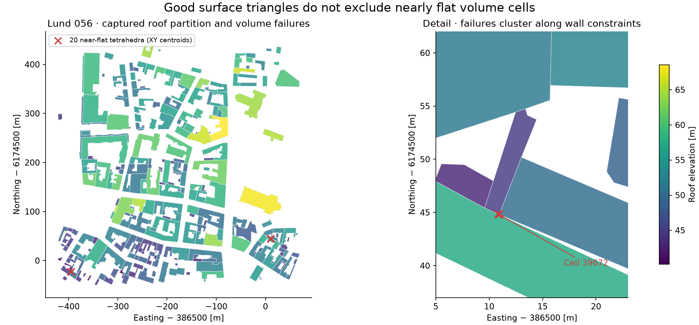
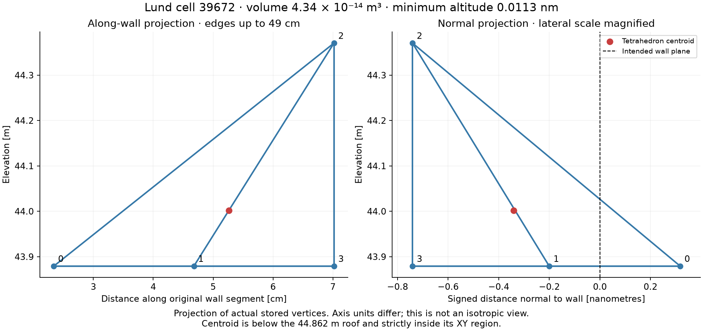
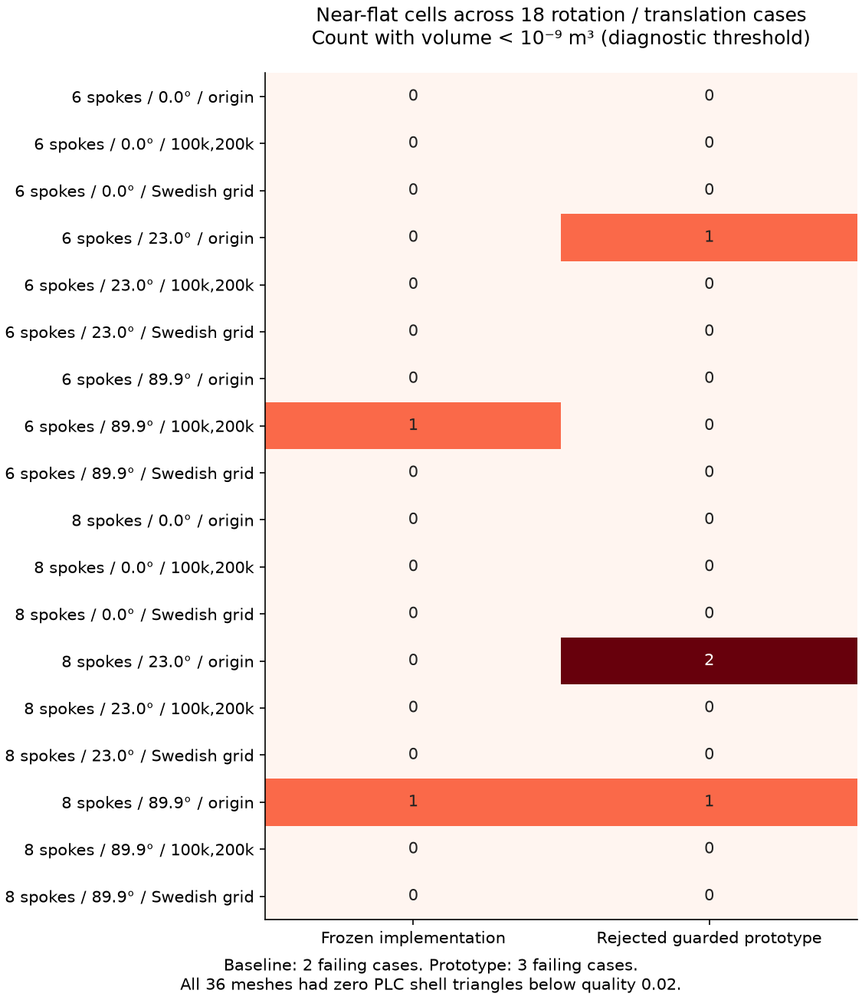

# Volume constraint regression evidence

This is a diagnostic attachment to the volume-meshing issue. It contains no proposed production fix. The captured cases preserve different roof heights and have good shell triangles, but contain almost-flat tetrahedra. The frozen core checkpoint is identified in `provenance.json`; **the core commit alone does not include the uncommitted height fixes**.

The primary reproduction is a captured TetGen input (PLC), so it works independently of core's cleaning implementation, raw point clouds, provider access, or the original scratch directory. All `.npz` files contain numeric arrays and load with `allow_pickle=False`.

## Replay and inspect

Use Python 3.11. The recorded environment used NumPy 2.4.6, Shapely 2.1.2 / GEOS 3.13.1 and the wrapper commit below. A native toolchain is needed to build the wrapper.

```sh
python3.11 -m venv .venv
.venv/bin/python -m pip install numpy==2.4.6 shapely==2.1.2 matplotlib
.venv/bin/python -m pip install 'dtcc-tetgen-wrapper @ git+https://github.com/dtcc-platform/dtcc-tetgen-wrapper.git@22ab9ff2ee1dd03f82ce24dd0f378f00da7e487c'
export OMP_NUM_THREADS=1 OPENBLAS_NUM_THREADS=1 VECLIB_MAXIMUM_THREADS=1
.venv/bin/python audit_volume.py lund
.venv/bin/python audit_volume.py synthetic-6
.venv/bin/python audit_volume.py synthetic-8
.venv/bin/python audit_volume.py lund --replay --output lund-replayed.npz
.venv/bin/python audit_volume.py synthetic-6 --replay --output six-replayed.npz
.venv/bin/python audit_volume.py synthetic-8 --replay --output eight-replayed.npz
```

**Exit code 1 is expected**: these cases reproduce defects. Native ordering may differ across platforms. Identical arrays were obtained when the three cases were replayed on the captured environment; otherwise compare geometry and metrics rather than cell numbers. Replays refuse to overwrite an existing output path. `tetgen-options.json` preserves the exact options for all three PLCs, including no quality refinement (`quality: null`) and exact arithmetic enabled.

| Case | Tetrahedra | Cells with volume < 1e-9 m³ | Minimum altitude (m, floating calculation) | Exact below-roof centroids |
|---|---:|---:|---:|---:|
| Lund 056 | 128278 | 20 | 1.1312e-11 | 5 |
| Synthetic six-spoke, 89.9°, offset (100000,200000) | 2115 | 1 | 1.6239e-11 | 1 |
| Synthetic eight-spoke, 89.9°, origin | 1077 | 1 | 1.4079e-16 | 0 |

For the eight-spoke case, the floating determinant estimates the minimum volume as 1.1842e-15 m³, versus 9.2030e-17 m³ using exact rational arithmetic on the stored doubles. Both describe an unusably flat element. `audit_volume.py` prints exact rational volumes for the tiny cells. Floating altitude calculations should not be mistaken for exact measurements at that scale.

The 1e-9 volume/altitude cutoffs are diagnostic bins for these metre-scale cases, not universal mesh-quality standards. The audit separates element degeneracy from strict roof-incursion checks. Its 1e-7 m spatial-query padding only selects candidates; the XY inclusion decisions use exact rational centroids and polygon edges. The existing 1e-6 m vertical margin is retained. This compact audit does not replace the full source-ownership, fidelity, roof-area and incidence validation required for an eventual fix.

## Reproduce the upstream synthetic pipeline

The six-spoke case has three high sectors and one low background (four sources); the eight-spoke case has four high sectors and one background (five sources). Each outer polygon has radius 10 m; alternating high sectors are truncated at radius 0.1 m. Their roofs are 20,25,30[,35] m; the background roof is 6 m. The stored sources already include the recorded rotation/translation.

In a **separate checkout** at core commit `48992e5b3b97c8bac2288e12ccf33615b64ad4bd`:

1. Apply `core-checkpoint.patch` with `git apply`.
2. Copy the GeoJSON files from `checkpoint-fixtures/` into `tests/data/cleaning/`.
3. Build core from its locked environment, with volume extras and a fresh native build: `uv sync --locked --python 3.11 --extra volume --reinstall-package dtcc-core`.
4. Run this directory's scripts with that environment's Python:

```sh
python reproduce_synthetic.py synthetic-6 --output /tmp/dtcc-six-new
python reproduce_synthetic.py synthetic-8 --output /tmp/dtcc-eight-new
```

The script uses public cleaning and volume-building APIs, a flat 4×4 terrain raster, detail 0.5 m, minimum building area 0, maximum mesh size 5 m and domain height 60 m. It also captures the actual PLC at the adapter boundary. The new output directory must not exist. Both cases were regenerated from this script and matched the saved vertices and cells exactly.

The real Lund case used detail 0.5 m, minimum building area 15 m², maximum mesh size 10 m and domain height 100 m. Its captured PLC avoids redistributing raw LiDAR or requiring live provider queries. `lund-native-2d.npz` additionally captures the ground mesher's graph and output; `earliest-stage-trace.json` records call options and provenance.

## Illustrations and diagnosis





The normal-distance panel explicitly magnifies the lateral dimension: normal distances are in nanometres while elevation is in metres. Coordinates are actual stored vertices. The elements are flat, not uniformly nanometre-sized.



`transform-matrix.json` records 36 actual meshes from 18 transformed inputs. The guarded prototype is rejected: it fixes some cases and introduces others. The nine-case initial success did not generalize. The illustrations are regenerated with `python plot_failures.py`.

The trace places 18 of 20 distinct implicated XY positions first in native 2D subdivision; two were input graph points. All 20 tiny Lund tetrahedra use existing PLC vertices. This identifies the construction chain to investigate, but does not establish which library must contain the fix. Exact predicates on rounded coordinates cannot by themselves restore intended collinearity.

Local-frame construction and guarded dyadic reconstruction are not adopted. The latter fails three of 18 transformed cases, with two strict centroid failures. `exact-lattice-proofs.json` concerns exact subdivisions of specific fixed endpoint pairs; it does not prove that a broader exact-construction kernel is necessary. An existing Triangle-backend comparison remains uncompleted because that backend was unavailable in the earlier locked environment.

Preserve roof heights, ownership, validity and strict audits. Do not fix this by flattening blocks, dropping tetrahedra, hiding crossings behind an enlarged tolerance, or adding more footprint repair families. Evaluate a minimal reproducer and the smallest correction before redesigning numerical interfaces. An eventual accepted change must rerun affected cleaning/surface tests, transformed volume cases, the full tile survey if shared 2D output changes, and controlled performance comparisons.

`checksums.json` records the packaged evidence. The patch contains only the existing tracked checkpoint changes; unrelated untracked project documentation is intentionally excluded.
